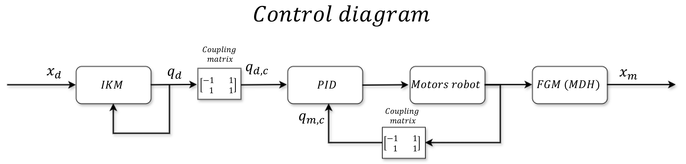
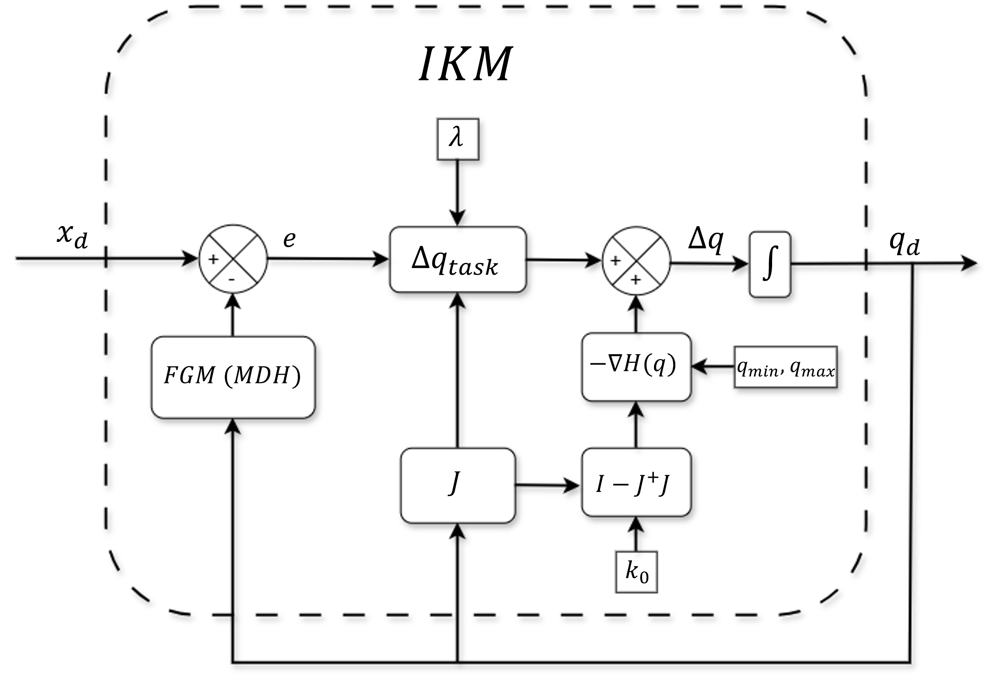
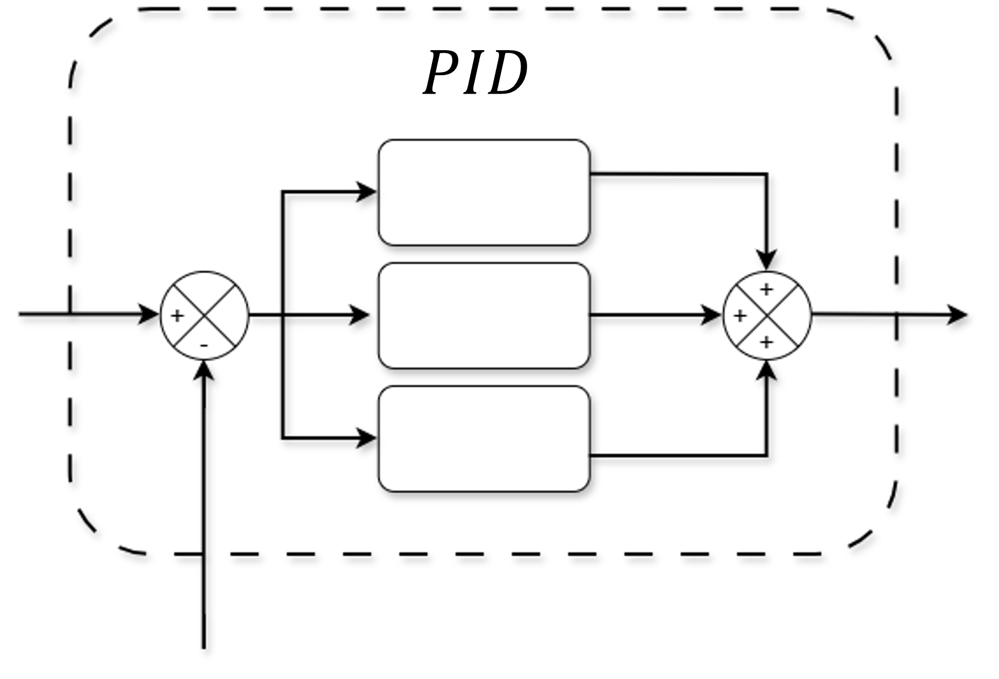

# Control Architecture

[](images/Control_diagram.png){ loading=lazy }

/// caption
Overall control pipeline of ProMice: Cartesian target → inverse kinematics → joint-space control.
///

!!! abstract "What you will find on this page"

    - How the **inverse kinematics (IK)** is solved on the Teensy with **Damped Least Squares (DLS)**.
    - How a **secondary task** (joint-limit avoidance) is added through the **null space** of the Jacobian.
    - How every equation maps to the C++ class `Model` in `model.h`.
    - Parameters, tuning advice and a minimal usage example.

!!! info "Related pages"

    The forward geometry used by the IK (the kinematic chain) is explained in [MDH model](modified_denavit_hartenberg.md).

---

## Inverse Kinematics via DLS with Null Space

### Overview

The arm has **4 active joints** and the task is to place the end-effector at a **3D position** \(x_{target} = [x,\,y,\,z]^T\). Since there are 4 unknowns for 3 equations, the arm is **redundant** (1 degree of freedom is left over). That extra freedom is exploited to keep the joints away from their mechanical limits.

| Symbol | Meaning |Size |
|:------:|---------|:----:|
| \(q\) | Joint vector \([\theta_1,\ \theta_2,\ \theta_4,\ \theta_5]^T\) in rad | 4 × 1 |
| \(x(q)\) | End-effector position given by the forward geometry (FG) | 3 × 1 |
| \(e\) | Task error \(x_{target}-x(q)\) | 3 × 1 |
| \(J\) | Positional Jacobian \(\partial x/\partial q\) | 3 × 4 |
| \(\lambda\) | Damping factor | scalar |
| \(k_0\) | Null-space gain | scalar |
| \(H(q)\) | Joint-limit cost function | scalar |

The algorithm runs **a fixed number of iterations** each time it is called:

```text
repeat IK_ITERS times:
    1. pos  = FG(q)                      # where is the end-effector now?
    2. e    = target - pos               # how far from the target?
    3. J    = numerical_jacobian(q)      # local linear model of the arm
    4. dq   = DLS(J, e) + null_space(J)  # joint increment
    5. q    = clamp(q + dq)              # update and respect limits
```

---

### Numeric computation of the Jacobian

The Jacobian is **not derived analytically**. Each column is approximated by finite differences of the forward geometry (FG), perturbing one joint at a time:

$$
J_{:,\,i} = \frac{\mathrm{FG}(q + \varepsilon\, e_i) - \mathrm{FG}(q)}{\varepsilon}, \qquad \varepsilon = 10^{-5}
$$

where \(e_i\) is the \(i\)-th canonical basis vector.

=== "Code"

    ```cpp title="model.h" linenums="1" hl_lines="7-11"
    void Model::numerical_jacobian(const float q_in[4], float J[3][4]) const {
        float p0[3], p1[3], qd[4];
        forwardGeometry(q_in, p0);                 // FG(q)

        for (int i = 0; i < 4; ++i) {
            for (int k = 0; k < 4; ++k) qd[k] = q_in[k];
            qd[i] += FK_EPS;                       // q + eps * e_i
            forwardGeometry(qd, p1);               // FG(q + eps * e_i)
            J[0][i] = (p1[0] - p0[0]) / FK_EPS;
            J[1][i] = (p1[1] - p0[1]) / FK_EPS;
            J[2][i] = (p1[2] - p0[2]) / FK_EPS;
        }
    }
    ```

=== "Why numerical?"

    - No need to re-derive the Jacobian if a link length or the kinematic chain changes.
    - The cost is only **5 FG evaluations** per Jacobian (1 nominal + 4 perturbed), which is cheap for a Teensy.

!!! warning "Choosing \(\varepsilon\) with 32-bit floats"

    The Teensy uses single precision (`float`, ~7 significant digits). If \(\varepsilon\) is too small, the subtraction `p1 - p0` loses precision (catastrophic cancellation) and the Jacobian becomes noisy. The code uses `FK_EPS = 1e-5`. If you notice jitter or poor convergence, try values between `1e-4` and `1e-3` rad.
---

### Damped Least Squares (DLS) Pseudoinverse

#### The idea

The classical pseudoinverse \(J^T(JJ^T)^{-1}\) explodes near **singularities** (configurations where the arm loses the ability to move in some direction, so \(JJ^T\) becomes almost non-invertible). DLS adds a small term \(\lambda^2 I\) that keeps the matrix invertible, at the price of a small tracking error.

$$
\Delta q_{task} = J^T \left(J J^T + \lambda^2 I\right)^{-1} e
$$

where \(e = x_{target} - x(q)\).

??? tip "Intuition for \(\lambda\)"

    | \(\lambda\) | Behaviour |
    |:-----------:|-----------|
    | Small | Accurate and fast convergence, but large joint motions near singularities |
    | Large | Smooth and safe near singularities, but slower convergence |

    The current value is `IK_LAMBDA = 0.05`.

#### Implementation 
!!! tip "solving a 3 × 3 system"
    The factor  \(JJ^T + \lambda^2 I\) is a **3 × 3 symmetric** matrix that we call \(A\). The code inverts it analytically using the **cofactor (Cramer) method**:

    $$
    A=JJ^T + \lambda^2 I
    $$
    
    $$
    A^{-1} = \frac{1}{\det A}\,\mathrm{adj}(A) = \frac{1}{\det A}\,C^T
    $$

    so that 
    
    $$
    x = A^{-1}e
    $$

    and finally 
    
    $$
    \Delta q_{task} = J^T x
    $$

```cpp title="model.h — wdls_step() (primary task)" linenums="1" hl_lines="3-9 30-32 35-36"
// A = J J^T + lambda^2 I   (3x3, symmetric)
const float l2 = IK_LAMBDA * IK_LAMBDA;
float A[3][3];
for (int i = 0; i < 3; ++i) {
    for (int j = 0; j < 3; ++j) {
        float s = 0.0f;
        for (int k = 0; k < 4; ++k) s += J[i][k] * J[j][k];   // (J J^T)_ij
        A[i][j] = s + (i == j ? l2 : 0.0f);
    }
}

// det(A) and its inverse
float det = A[0][0]*(A[1][1]*A[2][2] - A[1][2]*A[2][1])
          - A[0][1]*(A[1][0]*A[2][2] - A[1][2]*A[2][0])
          + A[0][2]*(A[1][0]*A[2][1] - A[1][1]*A[2][0]);
float inv_det = 1.0f / det;

// Cofactors C_ij  (C00, C01, ... C22)
float C00 =   A[1][1]*A[2][2] - A[1][2]*A[2][1];
float C10 = -(A[0][1]*A[2][2] - A[0][2]*A[2][1]);
float C20 =   A[0][1]*A[1][2] - A[0][2]*A[1][1];
float C01 = -(A[1][0]*A[2][2] - A[1][2]*A[2][0]);
float C11 =   A[0][0]*A[2][2] - A[0][2]*A[2][0];
float C21 = -(A[0][0]*A[1][2] - A[0][2]*A[1][0]);
float C02 =   A[1][0]*A[2][1] - A[1][1]*A[2][0];
float C12 = -(A[0][0]*A[2][1] - A[0][1]*A[2][0]);
float C22 =   A[0][0]*A[1][1] - A[0][1]*A[1][0];

// x = A^-1 * e
x[0] = inv_det * (C00*e[0] + C10*e[1] + C20*e[2]);
x[1] = inv_det * (C01*e[0] + C11*e[1] + C21*e[2]);
x[2] = inv_det * (C02*e[0] + C12*e[1] + C22*e[2]);

// dq_task = J^T * x
for (int i = 0; i < 4; ++i)
    dq_task[i] = J[0][i]*x[0] + J[1][i]*x[1] + J[2][i]*x[2];
```

!!! success "Why \(\det A\) never reaches zero"

    Since \(JJ^T\) is positive semi-definite, adding \(\lambda^2 I\) makes all eigenvalues of \(A\) at least \(\lambda^2 = 0.0025\). Therefore \(\det A \ge \lambda^6 > 0\) and `1.0f / det` is always safe, even at a singularity.

---

### Null space

#### Secondary task: Joint-limit avoidance

A redundant arm can move its joints **without changing the end-effector position**. The set of those motions is the **null space** of \(J\), obtained with the projector:

$$
N = I - J^+ J, \qquad J^+ = J^T \left(J J^T + \lambda^2 I\right)^{-1}
$$

Any motion of the form \(N\,v\) (for an arbitrary vector \(v\)) does not disturb the primary task. We use it to minimise a cost function \(H(q)\) by choosing \(v = -\nabla H(q)\) (gradient descent):

$$
\Delta q_{null} = k_0 \, N \, \bigl(-\nabla H(q)\bigr)
$$

!!! info "Task priority"

    The task priority is **strict**: the position tracking (primary) always has priority, and the joint-limit avoidance (secondary) only uses the leftover freedom.


#### Cost function: distance to the joint centre

$$
H(q) = \sum_{i=1}^{4} \left( \frac{q_i - q_{mid,i}}{q_{max,i} - q_{min,i}} \right)^2,
\qquad
q_{mid,i} = \frac{q_{max,i} + q_{min,i}}{2}
$$

\(H\) is **zero** when every joint is at the centre of its range and grows as joints approach their limits. Dividing by the range \(q_{max}-q_{min}\) **normalises** each joint, so that joints with different ranges are penalised fairly.

#### Gradient derivation

For a single joint, let \(\Delta q_i = q_{max,i}-q_{min,i}\):

$$
H_i(q_i) = \left(\frac{q_i - q_{mid,i}}{\Delta q_i}\right)^2
\quad\Longrightarrow\quad
\frac{\partial H_i}{\partial q_i} = \frac{2\,(q_i - q_{mid,i})}{(\Delta q_i)^2}
$$

Since each term depends on one joint only, the gradient is simply the stack of those derivatives:

$$
\nabla H(q) = \left[\;\frac{2\,(q_1 - q_{mid,1})}{(\Delta q_1)^2},\ \dots,\ \frac{2\,(q_4 - q_{mid,4})}{(\Delta q_4)^2}\;\right]^T
$$

#### Implementation
!!! tip "To implement we make:"
    
    $$
    N(-\nabla H)=(I - J^+J)(-\nabla H) = -\nabla H + J^+J\,\nabla H\
    $$

    Then:

    $$
    N_g=-\nabla H + J^+J\,\nabla H\
    $$

    And finally:
    
    $$
    \Delta q = \Delta q_{task} + k_0*N_g
    $$


```cpp title="model.h — wdls_step() (secondary task)" linenums="1" hl_lines="1-10 21-25"
// (1) J^+ J  (4x4)  using  J^+ = J^T A^-1
float JpJ[4][4];
for (int i = 0; i < 4; ++i) {
    float Jp[3];
    Jp[0] = inv_det*(C00*J[0][i] + C01*J[1][i] + C02*J[2][i]);
    Jp[1] = inv_det*(C10*J[0][i] + C11*J[1][i] + C12*J[2][i]);
    Jp[2] = inv_det*(C20*J[0][i] + C21*J[1][i] + C22*J[2][i]);
    for (int j = 0; j < 4; ++j)
        JpJ[i][j] = Jp[0]*J[0][j] + Jp[1]*J[1][j] + Jp[2]*J[2][j];
}

// (2) Gradient of H
float grad_H[4];
for (int i = 0; i < 4; ++i) {
    float q_mid = 0.5f*(Q_MAX[i] + Q_MIN[i]);
    float range = Q_MAX[i] - Q_MIN[i];
    grad_H[i] = 2.0f*(q_in[i] - q_mid) / (range*range);
}

// (3) dq = dq_task + k0 * (I - J^+ J) * (-grad H)
for (int i = 0; i < 4; ++i) {
    float Ng = -grad_H[i];                                  // I * (-grad H)
    for (int j = 0; j < 4; ++j) Ng += JpJ[i][j]*grad_H[j];  // + J^+J * grad H
    dq_out[i] = dq_task[i] + IK_NULL_K * Ng;
}
```
`Ng` accumulates: first `-grad_H[i]`, then `+ JpJ[i][j]*grad_H[j]`.


---

### Final control law

Combining both tasks, the update applied at every iteration is:

$$
\Delta q = \Delta q_{task} + k_0 N_g
$$

$$
\Delta q = J^T x + k_0 (-\nabla H + J^+J\,\nabla H)
$$

$$
\Delta q = J^T A^{-1} e + k_0 N (-\nabla H )
$$

$$
\boxed{\;
\Delta{q} = J^T \left(J J^T + \lambda^2 I\right)^{-1} e \;+\; k_0\,\bigl(I - J^+ J\bigr)\bigl(-\nabla H(q)\bigr)
\;}
$$

{ loading=lazy }
/// caption
Inverse kinematics block diagram: DLS primary task + null-space secondary task.
///

### Joints clamping
After each update the joints are **clamped** to their mechanical limits:

```cpp title="model.h — inverseKinematics()" linenums="1" hl_lines="17"
bool Model::inverseKinematics(const float target[3], float q_inout[4], float dq_out[4]) {
    for (int i = 0; i < 4; ++i) dq_out[i] = 0.0f;

    float e[3], J[3][4], dq[4], pos[3];

    for (int iter = 0; iter < IK_ITERS; ++iter) {
        forwardGeometry(q_inout, pos);
        e[0] = target[0] - pos[0];  e[1] = target[1] - pos[1];  e[2] = target[2] - pos[2];

        numerical_jacobian(q_inout, J);
        wdls_step(J, e, q_inout, dq);

        for (int i = 0; i < 4; ++i) {
            q_inout[i] += dq[i];     // update joints
            dq_out[i]  += dq[i];     // accumulate total variation
        }
        clamp_joints(q_inout);       // enforce limits
    }

    // Convergence check: |error|^2 < 1e-6  (i.e. |error| < 1e-3 mm)
    forwardGeometry(q_inout, pos);
    float err2 = 0.0f;
    for (int i = 0; i < 3; ++i) err2 += (target[i]-pos[i])*(target[i]-pos[i]);
    return (err2 < 1e-6f);
}
```

!!! note "Hard clamp vs. soft avoidance"

    The null-space term pushes the joints **softly** toward the centre of their range, while `clamp_joints()` is a **hard** safety net. The clamp guarantees the limits are never exceeded, but if it activates the DLS solution is no longer exact for that iteration.


---

## Model class reference

### Public interface

| Method | Description |
|--------|-------------|
| `forwardGeometry(q, xyz)` | Computes the end-effector position `xyz` (mm) from the joint angles `q` (rad) |
| `inverseKinematics(target, q, dq)` | Runs the DLS + null-space IK. Updates `q` in place, returns the total joint variation in `dq`, and returns `true` if converged |

### Joint mapping

The kinematic chain has 6 MDH rows, but only 4 are actuated. The other two are fixed.

| MDH row | Joint variable | Type |
|:-------:|:--------------:|------|
| 0 | `q[0]` = \(\theta_1\) | Active |
| 1 | `q[1]` = \(\theta_2\) | Active |
| 2 | 90° constant | Fixed |
| 3 | `q[2]` = \(\theta_4\) | Active |
| 4 | `q[3]` = \(\theta_5\) | Active (+90° offset) |
| 5 | 0 | Fixed wrist |

### Joint limits

| Joint | Min | Max |
|:-----:|:---:|:---:|
| \(\theta_1\) | −80° | +80° |
| \(\theta_2\) | −33° | +33° |
| \(\theta_4\) | −33° | +33° |
| \(\theta_5\) | −40° | +40° |

### Configuration parameters

```cpp title="model.h — tunable constants"
static const float IK_LAMBDA = 0.05f;   // damping factor (lambda)
static const int   IK_ITERS  = 10;      // iterations per call
static const float IK_NULL_K = 0.1f;    // null-space gain (k0)
static const float FK_EPS    = 1e-5f;   // finite-difference step (epsilon)
static const float DX = 0.0f, DY = 0.0f, DZ = 40.0f;  // global offset (mm)
```

| Parameter | Symbol | Default | Effect of increasing it |
|-----------|:------:|:-------:|-------------------------|
| `IK_LAMBDA` | \(\lambda\) | 0.05 | More robust near singularities, slower convergence |
| `IK_ITERS` | – | 10 | Better accuracy per call, more CPU time |
| `IK_NULL_K` | \(k_0\) | 0.1 | Stronger push toward the joint centres; too large may disturb the convergence |
| `FK_EPS` | \(\varepsilon\) | 1e-5 | Less numerical noise, but more linearisation error |
| `DZ` | – | 40 mm | Shifts the base frame of the chain upward |


!!! warning "Unreachable targets"

    If the target is outside the workspace, the IK returns `false` and `q` holds the closest configuration found. Always check the returned flag before sending `q` to the motors.

---

### PID

!!! info "Joint-space control"

    The IK produces the reference joint angles; a PID loop then makes each joint follow its reference.

{ loading=lazy }

/// caption
PID loop for each joint.
///

!!! question "To complete"

    The PID code was not part of `model.h`. Add here the control law \(u(t)=K_p e(t)+K_i\!\int e\,dt+K_d\,\dot e(t)\), the gains used and the sampling period.

### Sigmoid

!!! question "To complete"

    Describe here where the sigmoid is applied (e.g. smoothing of the reference or the control output) and its equation and parameters.

---

### PID control

!!! info "Joint-space control"

    The inverse kinematics (IK) solver provides the target joint angles, `q_tar_deg`. Before these targets are sent to the PID controllers, the trajectory generator creates a smooth reference, `q_ref`, between the starting and goal positions. Each joint has an independent PID controller that tries to minimize the difference between its reference angle and measured angle.

{ loading=lazy }

/// caption
PID loop for each joint. The controller calculates a bounded step command and selects a motor speed based on the command magnitude.
///

#### Control error and PID law

For joint \(i\), the position error is

\[
e_i[k] = q_{\mathrm{ref},i}[k] - q_{\mathrm{meas},i}[k]
\]

where `q_ref[i]` is the smoothed reference angle and `q_meas[i]` is the measured joint angle. The implementation uses a discrete PID law:

\[
u_i[k] = K_{p,i}e_i[k] + K_{i,i}I_i[k] + K_{d,i}D_i[k]
\]

The integral and derivative terms are updated each control cycle:

\[
I_i[k] = I_i[k-1] + e_i[k]\Delta t
\]

\[
D_{\mathrm{raw},i}[k] =
\frac{e_i[k]-e_i[k-1]}{\Delta t}
\]

The derivative is filtered with an exponential moving average (EMA):

\[
D_i[k] = \alpha_iD_i[k-1] +
(1-\alpha_i)D_{\mathrm{raw},i}[k]
\]

This filter reduces the effect of measurement noise and sudden changes in the error. A larger `alphaDerivative[i]` smooths the derivative more strongly but makes it respond more slowly. The configured value is `0.85` for all four motors.

The nominal control period is `dt_control = 10 ms` (100 Hz). The `dt` argument passed to `computePID()` must be expressed in **seconds** if the derivative and integral equations are to use standard time units. If the program passes milliseconds, convert them to seconds before using them in these equations. The actual loop period should be measured or calculated rather than assumed to be exactly nominal.

#### PID gains

The current per-joint gains are:

| Joint index | \(K_p\) | \(K_i\) | \(K_d\) |
| --- | ---: | ---: | ---: |
| 0 | 15 | 0.1 | 0.08 |
| 1 | 4 | 0.001 | 0.0005 |
| 2 | 3 | 0.001 | 0.0005 |
| 3 | 6 | 0.00 | 0.02 |

These are the values configured in the parameter file, not universal tuning values. Each joint can require different gains because its load, inertia, gearing, sensor noise and mechanical behavior may differ. `k_p(i)`, `k_i(i)` and `k_d(i)` select the gains for the relevant joint.

- **Proportional term (`Kp`)**: responds to the current position error. Increasing it usually makes the response stronger, but too much can cause overshoot or oscillation.
- **Integral term (`Ki`)**: accumulates error over time and can compensate for persistent offsets. Too much integral action can cause overshoot and accumulated integral error.
- **Derivative term (`Kd`)**: responds to the rate of change of error and can help damp the motion. It is sensitive to noise, which is why the derivative is filtered.

#### Saturation and anti-windup

The raw PID result is converted to an integer and limited to the permitted output range:

\[
u_i = \operatorname{constrain}
\left(\operatorname{int}(u_{\mathrm{raw},i}),
-L_i,\ L_i\right)
\]

The configured maximum output magnitudes are:

| Joint index | `outputLimit` |
| --- | ---: |
| 0 | 80 |
| 1 | 80 |
| 2 | 80 |
| 3 | 35 |

This saturation prevents a controller from requesting more steps per cycle than the configured limit. The fourth motor has a lower limit than the other three.

The code also limits the integral state to `[-integralLimit[i], +integralLimit[i]]`. The configured `integralLimit` is `2000` for each motor. In addition, the integral is not updated when the previous output is saturated and has the same sign as the current error. This is a simple **anti-windup** strategy: it reduces the risk of the integral term continuing to grow when the actuator is already at its limit and the error would push it further into saturation.

#### Position hysteresis

The controller uses two error tolerances to decide when a joint has reached its target:

- `enterTol = 0.5°`: when the joint is not in position and \(|e_i| < 0.5^\circ\), it is declared to be in position.
- `exitTol = 1.0°`: once in position, control is reactivated only when \(|e_i| > 1.0^\circ\).

This is **hysteresis**. The exit threshold is deliberately larger than the entry threshold, creating a band between `0.5°` and `1.0°`. Without this band, small measurement fluctuations near a single threshold could repeatedly switch the controller on and off, producing motor chatter or oscillation.

When a joint enters the in-position state, the code clears its integral and filtered derivative, sets the output to zero, and sends `M_STOP`. While it remains in position, the controller keeps the output at zero. If the error later exceeds the exit tolerance, normal control resumes.

#### Deadband

After the PID output is saturated, the code applies a deadband:

```cpp
if (abs(output[i]) < (int)deadband[i]) {
    output[i] = 0;
    prevError[i] = error[i];
    return;
}
```

The configured deadband is `2` steps for every motor. Outputs whose magnitude is less than `2` are discarded. This prevents tiny corrections caused by sensor noise from repeatedly moving the motors or creating vibrations near the target. Because this branch returns early, it also skips the step accumulation and RPM command for that cycle.

#### From PID output to motor steps and RPM

The bounded PID output is used as a fractional step command. The code accumulates it over cycles:

```cpp
stepAccumulator[i] += output[i];
int steps = (int)stepAccumulator[i];
stepAccumulator[i] -= steps;
```

The accumulator preserves the fractional remainder after converting the accumulated value to an integer. This can distribute small commands over multiple cycles instead of discarding their fractional part each time. The resulting `steps` value is then used to determine the motor speed command.

The code maps the absolute step count to a motor-specific RPM range:

\[
\mathrm{RPM}_i =
\operatorname{constrain}\left(
\operatorname{mapRange}
\left(|\mathrm{steps}|,0,L_i,
\mathrm{RPM}_{\min,i},\mathrm{RPM}_{\max,i}\right),
\mathrm{RPM}_{\min,i},\mathrm{RPM}_{\max,i}
\right)
\]

| Joint index | `rpm_min` | `rpm_max` |
| --- | ---: | ---: |
| 0 | 0.5 RPM | 8 RPM |
| 1 | 0.5 RPM | 6 RPM |
| 2 | 0.5 RPM | 6 RPM |
| 3 | 0.5 RPM | 3 RPM |

The minimum RPM is nonzero to help avoid stalling when a movement command is sent. Each motor has its own maximum speed, allowing the speed command to reflect its mechanical limits. The code sends this value through `M_SET_MAX_RPM`.

**Important implementation detail:** in the shown code, the sign of `output[i]` is not passed to `M_SET_MAX_RPM`; only the absolute value of `steps` is used to calculate RPM. The direction must therefore be handled elsewhere (for example, by the step command or motor-driver logic). Also verify that the motor firmware interprets `M_SET_MAX_RPM` as a speed limit and that another command actually initiates the required signed movement.

### Sigmoid trajectory generation

!!! info "Smooth reference generation"

    The sigmoid is applied to the **reference joint positions**, not directly to the PID output. It creates a smooth interpolation from each joint's starting position to its target position over the trajectory duration. The PID then tracks this changing reference.

At the beginning of a trajectory, the program stores the initial joint positions in `q_start[i]` and the desired final positions in `q_goal[i]`. The normalized progress variable `trajProgress` runs from `0.0` to `1.0`. For each of the four joints, the trajectory generator evaluates the sigmoid and calculates the reference angle:

```cpp
for (int i = 0; i < 4; i++) {
    float s = sigmoidMotor(i, trajProgress);
    q_ref[i] = q_start[i] + (q_goal[i] - q_start[i]) * s;
}
```

The reference is therefore

\[
q_{\mathrm{ref},i}(x) =
q_{\mathrm{start},i} +
\left(q_{\mathrm{goal},i}-q_{\mathrm{start},i}\right)s_i(x)
\]

where \(x=\texttt{trajProgress}\) and \(s_i(x)\) is the normalized sigmoid.

#### Sigmoid equation

The implementation starts with a decreasing logistic function:

\[
f_i(x)=\frac{1}{1+\exp(k_i(x-0.5))}
\]

The code calculates two endpoint values:

\[
s_0=\frac{1}{1+\exp(0.5k_i)}
\qquad
s_1=\frac{1}{1+\exp(-0.5k_i)}
\]

It then normalizes the logistic output:

\[
s_i(x)=\frac{f_i(x)-s_0}{s_1-s_0}
\]


#### Sigmoid parameter `k_sigmoid`

The configured values are:

```cpp
const float k_sigmoid[4] = {
    10.0f, 10.0f, 10.0f, 10.0f
};
```

`k_sigmoid[i]` controls the steepness of the transition:

- **Larger `k`**: the transition is more concentrated around the middle of the trajectory. The reference stays closer to its starting position for longer, then changes more rapidly near the midpoint, before flattening near the target.
- **Smaller `k`**: the transition is closer to a linear ramp, with less pronounced easing at the beginning and end.
- **`k = 10`**: all four joints currently use the same moderate-to-steep sigmoid profile. The value can be tuned per joint if different mechanisms need different motion profiles.

The sigmoid produces a smooth position reference with a gradual start and finish, which can reduce abrupt changes in the demanded motion compared with an immediate step from the start angle to the target angle. However, the sigmoid alone does not enforce motor velocity, acceleration or torque limits. Those limits still depend on the trajectory timing, PID behavior, RPM mapping and motor hardware.

#### Trajectory timing

The configured initial duration is `trajDuration = 2.0` seconds. The trajectory manager should update `trajProgress` from `0.0` to `1.0` over this duration, clamp it to that range, and set `trajActive` to `false` when the trajectory completes. For example, if progress is linear in time,

\[
x(t)=\operatorname{constrain}
\left(\frac{t-t_0}{T},0,1\right)
\]

where \(T\) is the trajectory duration and \(t_0\) is its start time. With `T = 2.0 s`, the reference reaches its goal after approximately two seconds. The exact timing depends on how the main program updates `trajProgress`.

`dt_control = 10 ms` is the nominal PID sampling interval. It is distinct from `trajDuration`: the sampling interval determines how often the controller updates, while the trajectory duration determines how long the reference takes to move from start to goal.

### Main parameters summary

| Parameter | Current value(s) | Purpose |
| --- | --- | --- |
| `dt_control` | 10 ms nominal | Nominal PID update interval |
| `trajDuration` | 2.0 s | Initial trajectory duration |
| `k_sigmoid` | 10 per joint | Sigmoid transition steepness |
| `outputLimit` | 80, 80, 80, 35 | Maximum absolute PID output |
| `integralLimit` | 2000 per joint | Integral clamp for anti-windup |
| `alphaDerivative` | 0.85 per joint | EMA smoothing of derivative |
| `enterTol` | 0.5° per joint | Error threshold to enter in-position state |
| `exitTol` | 1.0° per joint | Error threshold to leave in-position state |
| `deadband` | 2 steps per joint | Suppresses very small PID outputs |
| `rpm_min` | 0.5 RPM per joint | Minimum commanded RPM |
| `rpm_max` | 8, 6, 6, 3 RPM | Maximum RPM for each motor |


## References

1. Buss, S. R. (2004). [*Introduction to Inverse Kinematics with Jacobian Transpose, Pseudoinverse and Damped Least Squares Methods*](https://mathweb.ucsd.edu/~sbuss/ResearchWeb/ikmethods/iksurvey.pdf).
2. Siciliano, B., Sciavicco, L., Villani, L., & Oriolo, G. (2009). *Robotics: Modelling, Planning and Control*. Springer.
3. Nakamura, Y. (1991). *Advanced Robotics: Redundancy and Optimization*. Addison-Wesley.
