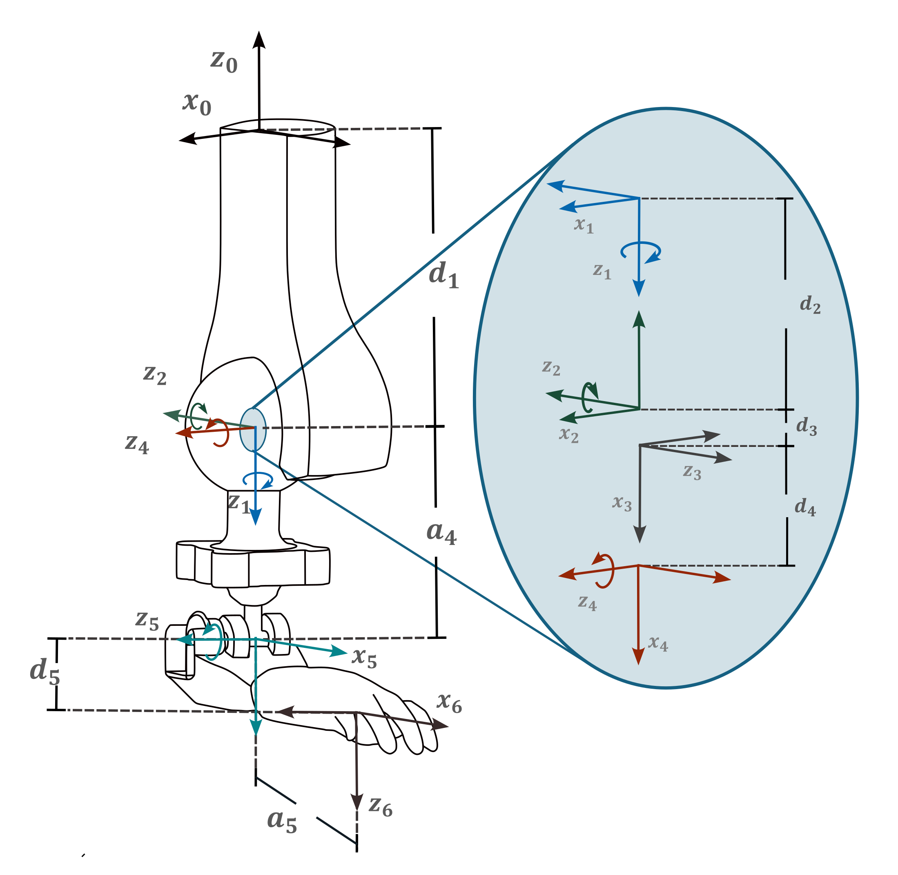
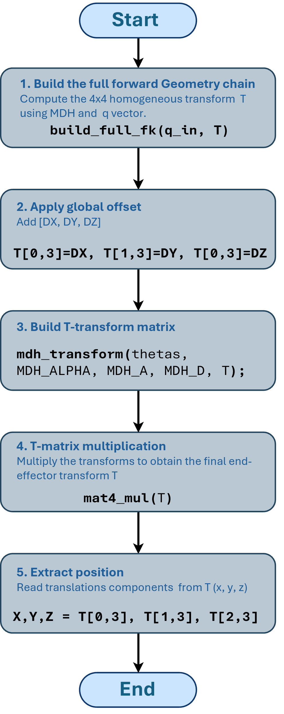

This section documents the direct geometric model implemented in `model.h`. The model uses the Modified Denavit--Hartenberg (MDH)
convention to calculate the end-effector Cartesian position from the four active joint angles.
## 1. MDH convention

!!! list "MDH convention"

    - Twist angle $\alpha_{i-1}$ is the angle between $z_{i-1}$ to $z_i$ measured about $x_{i-1}$
    
    - Link length $a_{i-1}$ is the distance from $z_{i-1}$ to $z_i$ measured along $x_{i-1}$
    
    - Offset length $d_{i-1}$ is the distance from $x_{i-1}$ to $x_i$ measured along $z_i$
    
    - Joint anglze $\theta_i$ is the angle between $x_{i-1}$ to $x_i$ measured about $z_i$

{width=500 .center}


The third coordinate frame is an auxiliary frame used to represent the spherical-joint rotations while satisfying the MDH frame constraints,
such as $\forall x$, $x_i$ $\perp$ $z_{i+1}$ . It is modelled as a fixed joint between frames 2 and 4.

The table below describes the six transformations in the kinematic chain. The model has four active joints; rows 3 and 6 are fixed
transformations.


!!! table "MDH table"
    |   Link  |    \(\theta_{i}\)(deg)   | \(\alpha_{i-1}\)(deg) | \(a_{i-1}\)(cm) | \(d_i\)(cm) |Join type |
    |:-------:|:------------------------:|:---------------------:|:---------------:|:-----------:|----------|
    | 1       | \(q_0 + \theta_{off,0}\) |  $180°$               |$0$              |$1.5$        |Revolute  |
    | 2       | \(q_1 + \theta_{off,1}\) |  $-90°$               |$0$              |$0$          |Revolute  |
    | 3       | $90°$                    |  $180°$               |$0$              |$0$          | Fixed    |
    | 4       | \(q_2 + \theta_{off,3}\) |  $90°$                |$0$              |$0$          |Revolute  |
    | 5       | \(q_3 + \theta_{off,4}\) |  $0°$                 |$1.3$            |$0$          |Revolute  |
    | 6       | \(0 + \theta_{off,5}\)   |  $90°$                |$2.0$            |$0.55$       | Fixed    |                                         


The joint-angle offsets are:
$$
\theta_{\text{off}} = \bigl[0,\; 0,\; -,\; 0,\; 90^\circ,\; 0\bigr]
$$


The angles supplied to the model are in **radians**. The table above
expresses the link dimensions in centimetres, while the C++ constants
store lengths in **millimetres**.

## 3. Homogeneous MDH transformation

For each row, the transformation from frame (i-1) to frame (i) is
computed using the MDH matrix:

$$
{}^{i-1}T_i =
\begin{bmatrix}
\cos\theta_i & -\sin\theta_i & 0 & a_{i-1} \\
\sin\theta_i\cos\alpha_{i-1} & \cos\theta_i\cos\alpha_{i-1} & -\sin\alpha_{i-1} & -d_i\sin\alpha_{i-1} \\
\sin\theta_i\sin\alpha_{i-1} & \cos\theta_i\sin\alpha_{i-1} & \cos\alpha_{i-1} & d_i\cos\alpha_{i-1} \\
0 & 0 & 0 & 1
\end{bmatrix}
$$

The method `mdh_transform()` in `model.h` implements this matrix
directly. It first calculates the sine and cosine of (`\theta`{=tex}*i)
and (`\alpha`{=tex}*{i-1}), then stores the 16 matrix elements in a
one-dimensional array in **row-major order**.

## 4. Building the complete forward-kinematics chain


{width=40% .center}


The implementation follows three main steps.

### 4.1 Define the angle for each MDH row

The method `build_full_fk()` expands the four active joint variables
into six MDH angles, including the fixed joints and the angular offsets:

``` cpp
float thetas[6];

thetas[0] = q_in[0] + MDH_THETA_OFF[0];
thetas[1] = q_in[1] + MDH_THETA_OFF[1];
thetas[2] = 1.57079633f + MDH_THETA_OFF[2]; // fixed 90 degrees
thetas[3] = q_in[2] + MDH_THETA_OFF[3];
thetas[4] = q_in[3] + MDH_THETA_OFF[4];
thetas[5] = 0.0f + MDH_THETA_OFF[5];
```

The MDH constants in `model.h` are stored in radians and millimetres:

``` cpp
static const float MDH_A[] = {0.0f, 0.0f, 0.0f, 0.0f, 13.0f, 20.0f};

static const float MDH_D[] = {15.0f, 0.0f, 0.0f, 0.0f, 0.0f, 5.50f};

static const float MDH_ALPHA[] = {
    3.14159265f,   // 180 degrees
   -1.57079632f,   // -90 degrees
    3.14159265f,   // 180 degrees
    1.57079632f,   // 90 degrees
    0.0f,          // 0 degrees
    1.57079632f    // 90 degrees
};

static const float MDH_THETA_OFF[] = {0.0f, 0.0f, 0.0f, 0.0f, 1.57079633f, 0.0f};
```

### 4.2 MDH Transformations
``` cpp title="model.h — build_full_fk()" 
void Model::build_full_fk(const float q_in[4], float T_out[16]) const {}
```

``` cpp
// Build theta for each row
    float thetas[6];
    thetas[0] = q_in[0] + MDH_THETA_OFF[0];
    thetas[1] = q_in[1] + MDH_THETA_OFF[1];
    thetas[2] = 1.57079633f + MDH_THETA_OFF[2]; // fixed 90 deg
    thetas[3] = q_in[2] + MDH_THETA_OFF[3];
    thetas[4] = q_in[3] + MDH_THETA_OFF[4];
    thetas[5] = 0.0f    + MDH_THETA_OFF[5];
```   
The initial transform is an identity matrix with a fixed translation of the base frame: `T[16]`.In this model, `DX` and `DY` are zero and `DZ` is 40 mm.
``` cpp
    // Initial transform: identity with global offset
    float T[16] = {
        1,0,0,DX,
        0,1,0,DY,
        0,0,1,DZ,
        0,0,0,1
    };

    float Ttmp[16], Tlink[16];
```

``` cpp
    for (int row = 0; row < 6; ++row) {
        mdh_transform(thetas[row], MDH_ALPHA[row], MDH_A[row], MDH_D[row], Tlink);
        mat4_mul(T, Tlink, Ttmp);
        for (int k = 0; k < 16; ++k) T[k] = Ttmp[k];
    }

    for (int k = 0; k < 16; ++k) T_out[k] = T[k];
``` 
For each of the six rows, the code calculates an individual MDH
transformation and post-multiplies it into the accumulated transform:


The resulting transformation is the complete chain from the base frame
to the final frame:


`T[16]` starts with the values representing a fixed global
translation. The multiplication order in the equation corresponds to the
order used in `build_full_fk()`.

The helper `mat4_mul()` computes the product of two (4`\times4`{=tex})
matrices stored in row-major arrays.

## 5. Obtaining the Cartesian position

The public method `forwardGeometry()` calls `build_full_fk()` and
extracts the translation column of the final homogeneous transformation:

``` cpp
void Model::forwardGeometry(
    const float q_in[4],
    float xyz_out[3]
) const {
    float T[16];

    build_full_fk(q_in, T);

    xyz_out[0] = T[3];
    xyz_out[1] = T[7];
    xyz_out[2] = T[11];
}
```

Mathematically, the direct geometric model is

\[ `\mathrm{FG}`{=tex}(q) =
```{=tex}
\begin{bmatrix}
x(q)\\
y(q)\\
z(q)
\end{bmatrix}
```
=
```{=tex}
\begin{bmatrix}
T_{\mathrm{final}}[0,3]\\
T_{\mathrm{final}}[1,3]\\
T_{\mathrm{final}}[2,3]
\end{bmatrix}
```
\]

Thus, `forwardGeometry(q, xyz)` maps the four joint angles (q), in
radians, to the end-effector position ((x,y,z)), in millimetres.


Each column (J\_{:,i}) corresponds to one of the four active joints, and
each row corresponds to a Cartesian coordinate (x), (y), or (z). Since
the input angles are in radians and the Cartesian coordinates are in
millimetres, the Jacobian entries have units of **mm/rad**.

The numerical Jacobian is used by the inverse-kinematics solver to
relate Cartesian position error to joint-angle updates.
