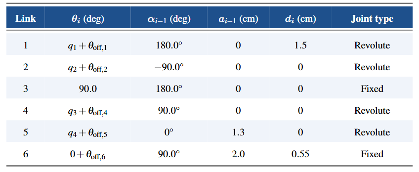

!!! list "MDH convention"

    - Twist angle $\alpha_{i-1}$ is the angle between $z_{i-1}$ to $z_i$ measured about $x_{i-1}$
    
    - Link length $a_{i-1}$ is the distance from $z_{i-1}$ to $z_i$ measured along $x_{i-1}$
    
    - Offset length $d_{i-1}$ is the distance from $x_{i-1}$ to $x_i$ measured along $z_i$
    
    - Joint anglze $\theta_i$ is the angle between $x_{i-1}$ to $x_i$ measured about $z_i$

{width=500 .center}

The system 3 is a supplementary system to add rotations to the spherical joint. This allows to respect DH restrictions,
such as $\forall x$, $x_i$ $\perp$ $z_{i+1}$ . It acts as a fixed joint between system 2 and system 4.

!!! list "MDH table"
    |   Link  |    \(\theta_{i}\)(deg)   | \(\alpha_{i-1}\)(deg) | \(a_{i-1}\)(cm) | \(d_i\)(cm) |Join type |
    |:-------:|:------------------------:|:---------------------:|:---------------:|:-----------:|----------|
    | 1       | \(q_0 + \theta_{off,0}\) |  $180°$               |$0$              |$1.5$        |Revolute  |
    | 2       | \(q_1 + \theta_{off,1}\) |  $-90°$               |$0$              |$0$          |Revolute  |
    | 3       | 90°                      |  $180°$               |$0$              |$0$          | Fixed    |
    | 4       | \(q_2 + \theta_{off,3}\) |  $90°$                |$0$              |$0$          |Revolute  |
    | 5       | \(q_3 + \theta_{off,4}\) |  $0°$                 |$1.3$            |$0$          |Revolute  |
    | 6       | \(0 + \theta_{off,5}\)   |  $90°$                |$2.0$            |$0.55$       | Fixed    |                                         

{width .center}

$$
{}^{i-1}T_i =
\begin{bmatrix}
\cos\theta_i & -\sin\theta_i & 0 & a_{i-1} \\
\sin\theta_i\cos\alpha_{i-1} & \cos\theta_i\cos\alpha_{i-1} & -\sin\alpha_{i-1} & -d_i\sin\alpha_{i-1} \\
\sin\theta_i\sin\alpha_{i-1} & \cos\theta_i\sin\alpha_{i-1} & \cos\alpha_{i-1} & d_i\cos\alpha_{i-1} \\
0 & 0 & 0 & 1
\end{bmatrix}
$$
